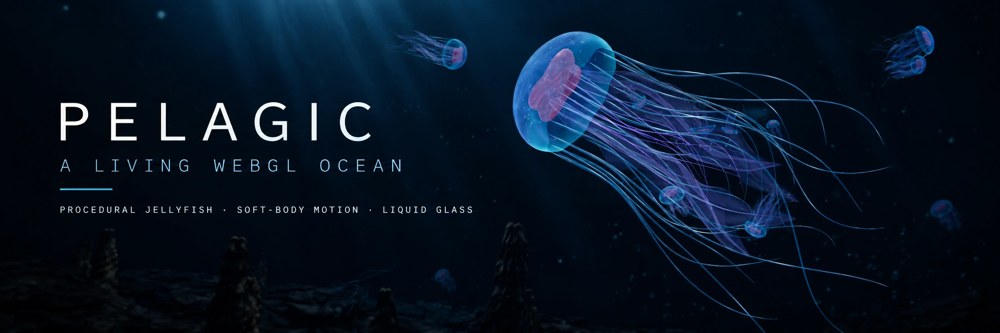
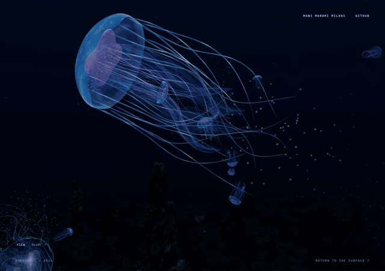
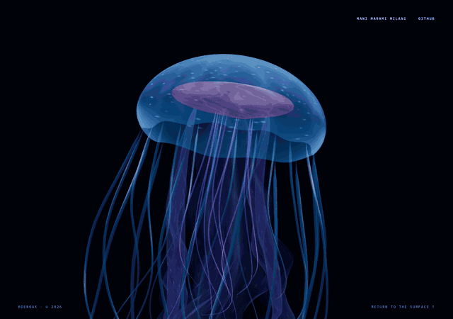
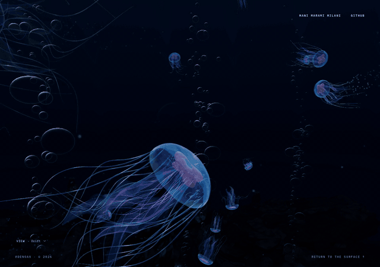
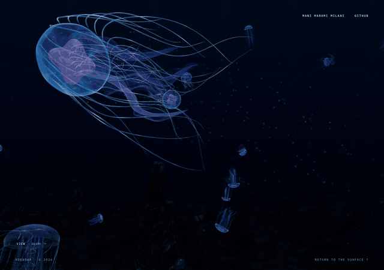

<div align="center">

**Real-time procedural jellyfish, soft-body animation, underwater optics, and interactive liquid glass in Three.js**

[Live demo](https://denoax.github.io/pelagic-jellyfish-webgl/) · [Architecture](#architecture) · [Run locally](#run-locally) · [Reproduce](REPRODUCIBILITY.md)

</div>

Pelagic is an interactive underwater scene built as one continuous WebGL experience. Procedural animals swim through a current-coupled ocean, the camera follows an authored descent into a basalt sanctuary, and the live scene becomes the source for bubbles, thermal shimmer, and an idle liquid clock.

The project favors visible systems over presentation-only effects: jellyfish geometry deforms, appendages retain history, distant animals change detail with projected size, and optical effects sample the current ocean render.



## Highlights

- **Procedural anatomy** — continuous bell, rim, oral membranes, and tentacle roots built from shared geometry contracts.
- **Pulse-driven locomotion** — contraction, refill, coast, turning, and current response drive translation and appendage lag.
- **Persistent soft bodies** — constrained point histories preserve motion through body transforms instead of rebuilding each frame.
- **Projected-size detail** — near, medium, and far animals share state while changing rendering cost with screen size.
- **Connected water** — local currents, wakes, marine snow, and population response use the same bounded world-space field.
- **Abyssal sanctuary** — procedural basalt layers, sediment, vents, sparse life, and distance extinction form the deep scene.
- **Shared optics** — bubbles, thermal shimmer, and idle liquid effects reuse one clean ocean color/depth source.
- **Native interaction** — scroll, pointer movement, animal activation, keyboard dismissal, reduced motion, and graphics recovery.

| Procedural appendages | Live refraction | Liquid idle state |
| --- | --- | --- |
|  |  |  |

## Architecture

| Area | Source | Responsibility |
| --- | --- | --- |
| Application shell | [`src/App.jsx`](src/App.jsx) | Lifecycle, accessibility, navigation, and scene ownership |
| Main scene | [`src/scene/HeroScene.jsx`](src/scene/HeroScene.jsx) | Renderer, ocean target, update loop, and recovery |
| Anatomy | [`src/scene/anatomy/`](src/scene/anatomy/) | Bell and shared surface geometry |
| Motion | [`src/scene/jellyMotion.js`](src/scene/jellyMotion.js), [`LivingAppendages.js`](src/scene/LivingAppendages.js) | Pulse state, locomotion, and constrained appendages |
| Population | [`src/scene/population/`](src/scene/population/) | Animal lifecycle, passage warmup, and LOD |
| Ocean | [`src/scene/ocean/`](src/scene/ocean/) | Currents, wakes, and marine snow |
| Camera | [`src/scene/camera/`](src/scene/camera/) | Journey tracks, views, and user exploration |
| Sanctuary | [`src/scene/sanctuary/`](src/scene/sanctuary/) | Basalt, vents, sediment, atmosphere, and life |
| Optics | [`src/scene/glass/`](src/scene/glass/) | Refraction, bubbles, and liquid-clock composition |
| Hosting | [`worker/index.js`](worker/index.js) | Static-hosting fallback and route handling |

State remains local to each subsystem. The scene owns one renderer and one primary ocean render target; optical passes consume that target instead of mounting another ocean or renderer.

## Interaction

| Input | Result |
| --- | --- |
| Scroll | Travel through the authored ocean journey |
| View menu | Select a camera track or Explore mode |
| Pointer movement | Disturb nearby water and animal motion |
| Click or tap an animal | Trigger a local bioluminescent response and recoil |
| 30 seconds idle | Enter the liquid-clock state |
| Click, tap, Enter, Escape, or Space | Return from idle |

Reduced-motion users receive a static compatibility presentation instead of the animated idle renderer.

## Run locally

Pelagic uses Node.js 24 and the committed npm lockfile.

```sh
git clone https://github.com/Denoax/pelagic-jellyfish-webgl.git
cd pelagic-jellyfish-webgl
npm ci
npm run dev
```

Production build and deterministic tests:

```sh
npm run build
node --test tests/*.test.mjs
npm run test:sites
```

GitHub Pages builds with:

```sh
VITE_BASE_PATH=/pelagic-jellyfish-webgl/ npm run build
```

## Repository layout

```text
src/                 application and rendering systems
tests/               deterministic behavior and release contracts
public/              runtime artwork and the active geology texture
docs/readme/          curated README media
scripts/              build packaging and one test probe
worker/               static-hosting worker
licenses/             third-party notices
```

Historical milestone captures, rejected experiments, raw profiling output, and publication build intermediates are intentionally kept out of the current tree. Git history preserves the development record without making every checkout carry it.

## Scope and limitations

Pelagic is an art-directed real-time rendering project, not a biological or fluid-dynamics simulator. Its soft bodies use geometric constraints, its current field is bounded and authored, and its liquid effects do not conserve physical volume. Image-space refraction cannot recover scene information that was never rendered.

The primary validated path is hardware WebGL2. Browser emulation covers multiple viewport sizes but is not physical-device testing. Performance varies with GPU, browser, resolution, and enabled effects; no universal frame-rate claim is made.

## Provenance and licensing

Original software is MIT licensed. Original documentation and project-generated media use CC BY 4.0. Third-party code, fonts, textures, and artwork retain their own terms.

- [Asset provenance](ASSET_PROVENANCE.md)
- [Licensing policy](LICENSE.md)
- [Contribution guide](CONTRIBUTING.md)
- [Citation metadata](CITATION.cff)

## Citation

```bibtex
@software{marami_milani_pelagic_2026,
  author = {Marami Milani, Mani},
  title = {Pelagic: A Living WebGL Ocean},
  year = {2026},
  url = {https://github.com/Denoax/pelagic-jellyfish-webgl}
}
```
